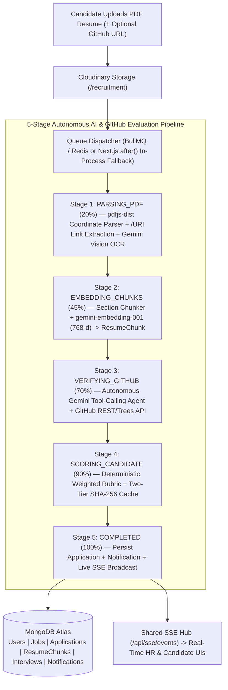

<div align="center">

# TalentaSync — AI Talent Matcher & GitHub-Verified Recruitment SaaS

**An enterprise-grade, AI-native technical recruitment platform powered by Hybrid RAG (768-d Vector Search + BM25 RRF), Coordinate-Aware PDF Parsing, Autonomous GitHub Tool-Calling Verification, Real-Time SSE Streaming, and Deterministic Multi-Stage Rubric Scoring.**

[](https://nextjs.org/)
[](https://react.dev/)
[](https://www.typescriptlang.org/)
[](https://ai.google.dev/)
[](https://www.mongodb.com/)
[](https://docs.bullmq.io/)
[](https://tailwindcss.com/)

</div>

---

## Overview

Traditional Applicant Tracking Systems (ATS) rely on brittle keyword matching and unverified resume claims, allowing keyword-stuffed CVs to pass while overlooking genuinely skilled engineers.

**TalentaSync (AI Talent Matcher)** solves this with a **5-Stage Autonomous Evaluation Pipeline** that:
1. Reconstructs multi-column PDF resumes using **coordinate-aware layout parsing** (`pdfjs-dist`) and extracts embedded hyperlink annotations (`/URI`) directly from the PDF binary—automatically falling back to **Gemini Multimodal Vision OCR** for scanned documents.
2. Segments resumes into semantic sections (`summary`, `experience`, `projects`, `skills`, `education`) and indexes **768-dimensional L2-normalized vector embeddings** (`gemini-embedding-001`) into MongoDB `ResumeChunk`.
3. Powers natural-language **Recruiter Talent Pool Semantic Search (`/hr/candidates`)** via **Hybrid RAG**—combining **MongoDB Atlas `$vectorSearch`** (with an automatic in-memory dot-product fallback) and **BM25 Lexical Scoring** through **Reciprocal Rank Fusion (RRF, $k=60$)**.
4. Runs an **Autonomous GitHub Tool-Calling Verification Agent** (`github-verification.agent.ts` + `github-tool.service.ts`) that inspects public authored repositories (excluding forks), recursive Git Trees, and dependency manifests (`package.json`, `requirements.txt`, `pyproject.toml`, `go.mod`, `Cargo.toml`, `pom.xml`) with ETag conditional caching.
5. Computes a **deterministic, XML-spotlighted composite score** (`Skills 40% + Experience 35% + GitHub Verification 15% + Education 10%`) backed by a **Two-Tier SHA-256 Idempotency Cache** (`Redis` + bounded in-memory + MongoDB recovery) and broadcasts live stage progress via **Server-Sent Events (`/api/sse/events`)**.

---

## System Architecture & 5-Stage AI Pipeline



---

## Core Engineering Highlights

### 1. Coordinate-Aware PDF Parser & Multimodal OCR Fallback (`src/services/pdf-parser.service.ts`)
- **Spatial Line & 2-Column De-Interleaving**: Uses `pdfjs-dist` transformation matrices `(x, y)` to detect 2-column layouts and reconstruct reading order without scrambling adjacent columns.
- **Embedded Annotation & Hyperlink Extraction**: Reads PDF page `/Annots` (`/URI`) links alongside inline URLs to capture clickable GitHub and portfolio links even when visible text only says *"GitHub"*.
- **Automatic Gemini Vision OCR Fallback**: If native extraction yields `< 150 chars/page` (scanned or Canva/Figma outline PDFs), automatically invokes Gemini Flash (`generateContentWithFallback`) with inline `application/pdf` base64 data.
- **Prompt Injection Defense & Section Chunking**: Redacts known prompt-injection directives, splits into canonical sections (`summary`, `experience`, `projects`, `skills`, `education`), and caps output at 8 context-prefixed chunks per resume.

### 2. Hybrid RAG & Semantic Talent Pool Search (`src/lib/gemini.ts`, `src/services/hybrid-search.service.ts`)
- **768-d Vector Indexing**: Generates L2-normalized `768`-dimensional vectors using Google's `gemini-embedding-001` (`RETRIEVAL_DOCUMENT` for resume chunks, `RETRIEVAL_QUERY` for recruiter queries).
- **Resilient Multi-Model Flash Failover**: `generateContentWithFallback()` tries an ordered low-latency Flash chain (`gemini-3.5-flash-lite` $\rightarrow$ `gemini-3.1-flash-lite` $\rightarrow$ `gemini-3.5-flash` $\rightarrow$ `gemini-3.6-flash`) with `AbortController` timeouts so temporary `503` spikes never break evaluations.
- **Hybrid Retrieval with Reciprocal Rank Fusion (RRF, $k = 60$)**: Combines MongoDB Atlas `$vectorSearch` (or exact in-memory dot-product fallback) with BM25 lexical scoring ($\text{RRF}(d) = \sum \frac{1}{60 + \text{rank}(d)}$) and groups chunks by `candidateId` (Parent-Document Retrieval).

### 3. Autonomous GitHub Tool-Calling Verification Agent (`src/services/github-verification.agent.ts`, `src/services/github-tool.service.ts`)
- **Smart Handle Discovery**: Accepts an optional candidate GitHub link, extracts root profile URLs and explicit `GitHub:` labels from PDF text/annotations, and deprioritizes third-party framework orgs (e.g., `vercel`, `facebook`, `google`).
- **Bounded 4-Iteration Tool Loop**: Gemini autonomously calls `getGithubUserProfile`, `getAuthoredRepositories` (filtering `fork === false && size > 0`), and `inspectRepoDependencies` (recursively decoding manifests up to monorepo depth 2) with ETag `304 Not Modified` caching and XML `<untrusted_candidate_data>` spotlighting.
- **Asymmetric Evidence Invariant**: Public authored code provides positive proof (`> 70`), while private enterprise repositories or absent handles remain neutral (`70`) so corporate engineers are never falsely penalized.

### 4. Deterministic Weighted Rubric & Two-Tier SHA-256 Cache (`src/services/ai-scoring.service.ts`, `src/services/idempotency-cache.service.ts`)
- **Strict JSON Schema & TypeScript Arithmetic**: Enforces `responseSchema` at `temperature: 0.1` and computes the final composite score deterministically in TypeScript:
  $$\text{Match Score} = \text{round}\big(0.40 \times \text{Skills} + 0.35 \times \text{Experience} + 0.15 \times \text{GitHub} + 0.10 \times \text{Education}\big)$$
- **Two-Tier Content-Addressable Cache**:
  - **Tier 1 (`cache:resume:<resumeTextHash>`)**: Caches parsed sections, 768-d embeddings, and GitHub report for 7 days.
  - **Tier 2 (`cache:eval:<resumeTextHash>:<jobRequirementsHash>`)**: Caches job-specific evaluation with automatic invalidation whenever HR edits job requirements (`RUBRIC_VERSION = "v1"`), backed by MongoDB recovery across cold starts.

### 5. Async Queue, Real-Time Shared SSE & Three-Tier RBAC
- **BullMQ + Next.js `after()` Fallback (`src/queues/ai-evaluation.queue.ts`, `src/workers/ai-evaluation.worker.ts`)**: Dispatches to BullMQ when Redis + workers are active (`concurrency: 5`, `lockDuration: 90s`), or runs asynchronously in-process via Next.js `after()`.
- **Shared Per-Tab SSE Hub (`src/lib/client-sse.ts`, `app/api/sse/events/route.ts`, `src/lib/sse-bus.ts`)**: Streams `SNAPSHOT`, `NOTIFICATION_CREATED`, `APPLICATION_CREATED`, `AI_PIPELINE_PROGRESS`, and `AI_PIPELINE_COMPLETED` over a single shared `EventSource` per browser tab, backed by Redis Pub/Sub + in-process `EventEmitter`.
- **Hardened Multi-Role RBAC (`proxy.ts`, `src/lib/auth-server.ts`)**:
  - Dedicated portals for **Candidate (`/candidate/*`)**, **HR / Recruiter (`/hr/*`, `/hr/login`)**, and **System Admin (`/admin/*`)** plus Google OAuth onboarding (`/select-role`).
  - Edge JWT verification (`jose` HS256 HTTP-only cookies), dynamic `/[role]/profile` & `/[role]/settings` protection, Google onboarding gate enforcement, ownership checks across all Server Actions, SSRF-protected CV proxy streaming (`/api/download`), and brute-force rate limiting (`rate-limiter-flexible`).

---

## Tech Stack

| Layer | Technologies |
| :--- | :--- |
| **Frontend & UI** | Next.js 16.2 (App Router + Server Actions), React 19.2, TypeScript 5, Tailwind CSS v4, Shadcn UI, Radix UI, Framer Motion, Recharts, Lucide Icons, Zustand |
| **AI & RAG Engine** | Google GenAI SDK (`@google/genai`), Gemini Flash Multi-Model Failover (`gemini-3.5-flash-lite` / `3.1-flash-lite` / `3.5-flash`), `gemini-embedding-001` (`768-d` L2-normalized), Hybrid `$vectorSearch` + BM25 RRF ($k=60$) |
| **PDF & Verification** | `pdfjs-dist` (Coordinate-Aware Layout + `/Annots` Link Extractor), GitHub REST & Git Trees API (`ETag` Cached), Cloudinary (`v2` Stream Upload) |
| **Queue, Realtime & DB** | MongoDB Atlas & Mongoose 9.4, BullMQ 5.40 & `ioredis` 6.0 (with 30s auto-recovery cooldown), Server-Sent Events (SSE + Redis Pub/Sub) |
| **Security & Validation** | `jose` & `jsonwebtoken` (15m Access + 7d Refresh HTTP-only Cookies), Google OAuth 2.0 (CSRF `state`), `bcryptjs`, `zod` v4, `rate-limiter-flexible` |

---

## Project Structure

```text
ai-talent-matcher-main/
├── app/
│   ├── (auth)/                  # /login, /register, /hr-login (rewritten from /hr/login)
│   ├── (dashboard)/             # Protected multi-role portals & responsive layouts
│   │   ├── admin/               # Admin dashboard, user management, job moderation, analytics
│   │   ├── candidate/           # Candidate dashboard, job board, applications, schedule
│   │   ├── hr/                  # HR dashboard, jobs, live-SSE applications, Hybrid RAG candidates, schedule
│   │   └── [role]/              # Role-protected dynamic profile & security settings
│   ├── api/
│   │   ├── auth/                # Google OAuth, callback, /me, /refresh-token, /set-role
│   │   ├── download/            # SSRF-safe authenticated CV PDF proxy (?id= or ?url=)
│   │   └── sse/events/          # Real-time Server-Sent Events stream
│   ├── jobs/                    # Public open positions directory
│   └── select-role/             # Post-Google-OAuth role onboarding gate
├── components/
│   ├── dashboard/               # Scorecards, modals, charts, live SSE tables
│   ├── layout/                  # Responsive Navbar, Sidebar, NotificationBell
│   └── ui/                      # Shadcn + Radix design-system primitives
├── src/
│   ├── actions/                 # Authenticated Next.js Server Actions (auth, jobs, applications, candidates, interviews, stats, users, notifications)
│   ├── lib/                     # auth-server, db, gemini, redis, sse-bus, client-sse, validations
│   ├── models/                  # Mongoose schemas (User, Job, Application, ResumeChunk, Interview, Notification)
│   ├── queues/                  # BullMQ queue producer + Next.js after() fallback
│   ├── services/                # ai-pipeline.orchestrator, ai-scoring, github-verification.agent, github-tool, hybrid-search, idempotency-cache, pdf-parser
│   ├── store/                   # Zustand persisted auth store
│   └── workers/                 # Dedicated BullMQ worker (ai-evaluation.worker.ts)
├── scripts/
│   ├── seed.ts                  # Comprehensive database seeder
│   └── e2e-workflow-test.ts     # Automated 8-stage E2E test & latency benchmark suite
├── proxy.ts                     # Next.js Edge request proxy for JWT auth, RBAC & onboarding gates
└── next.config.ts               # Rewrites (/hr/login -> /hr-login), CORS headers, pdfjs external config
```

---

## Getting Started

### 1. Prerequisites
- **Node.js** `>= 20.x`
- **MongoDB Atlas** cluster (or local MongoDB instance)
- **Google Gemini API Key** (`GEMINI_API_KEY`)
- **Cloudinary Account** (for PDF resumes and user avatars)
- *(Optional)* **GitHub Personal Access Token** (`GITHUB_PAT`) for `5,000 req/hr` rate limit during code audits
- *(Optional)* **Google OAuth Credentials** (`GOOGLE_CLIENT_ID`, `GOOGLE_CLIENT_SECRET`, `NEXTAUTH_URL`)
- *(Optional)* **Redis** (`REDIS_URL`) for BullMQ background workers & multi-instance SSE Pub/Sub (falls back seamlessly to in-process execution if offline)

### 2. Installation

```bash
git clone https://github.com/Faseehmasood/ai-talent-matcher.git
cd ai-talent-matcher
npm install
```

### 3. Environment Variables

Create a `.env.local` file in the project root:

```env
# Database
MONGODB_URI=mongodb+srv://<username>:<password>@<cluster>.mongodb.net
DB_NAME=talentasync

# Authentication (HS256 Access & Refresh Secrets)
ACCESS_TOKEN_SECRET=your_access_token_secret
REFRESH_TOKEN_SECRET=your_refresh_token_secret

# Google OAuth 2.0 (Optional)
NEXTAUTH_URL=http://localhost:3000
GOOGLE_CLIENT_ID=your_google_client_id
GOOGLE_CLIENT_SECRET=your_google_client_secret

# Google Gemini AI (gemini-3.5-flash-lite failover chain + gemini-embedding-001)
GEMINI_API_KEY=your_google_gemini_api_key

# Cloudinary (Resume PDF & Avatar Storage)
CLOUDINARY_CLOUD_NAME=your_cloud_name
CLOUDINARY_API_KEY=your_cloudinary_api_key
CLOUDINARY_API_SECRET=your_cloudinary_api_secret

# GitHub REST & Git Trees API Token (5,000 req/hr authenticated quota)
GITHUB_PAT=ghp_your_github_personal_access_token

# Optional: Redis for BullMQ Background Worker & SSE Pub/Sub
REDIS_URL=redis://127.0.0.1:6379
```

### 4. Seed Demo Data (Optional)

```bash
npm run seed
```

**Default Demo Credentials (Password for all accounts: `Password123!`):**
| Role | Email | Portal Entry |
| :--- | :--- | :--- |
| **HR / Recruiter** | `elena.recruiter@vercel.com` | `/hr/login` |
| **Candidate** | `ali.fullstack@gmail.com` | `/login` |
| **System Admin** | `admin@talentasync.com` | `/login` |

### 5. Run the Application & Optional BullMQ Worker

```bash
# Start Next.js development server on http://localhost:3000
npm run dev

# (Optional) Start the dedicated BullMQ background worker in a second terminal
npm run worker
```

### 6. Run the Automated E2E Workflow & Benchmark Suite

```bash
npm run test:e2e
```

---

## License

Designed and engineered by [**Faseeh Masood**](https://github.com/Faseehmasood).
