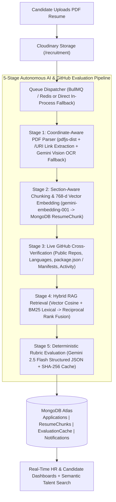

<div align="center">

# TalentaSync — AI Talent Matcher & GitHub-Verified Recruitment SaaS

**An enterprise-grade, AI-native technical recruitment platform powered by Hybrid RAG (768-d Vector Search + BM25 RRF), Coordinate-Aware PDF Parsing, Live GitHub Code Verification, and Deterministic Multi-Stage Rubric Scoring.**

[](https://nextjs.org/)
[](https://react.dev/)
[](https://www.typescriptlang.org/)
[](https://ai.google.dev/)
[](https://www.mongodb.com/)
[](https://docs.bullmq.io/)
[](https://tailwindcss.com/)

</div>

---

## Overview

Traditional Applicant Tracking Systems (ATS) rely on brittle keyword matching and unverified resume claims, allowing keyword-stuffed CVs to pass while overlooking genuinely skilled engineers.

**TalentaSync (AI Talent Matcher)** solves this with a **5-Stage Autonomous Evaluation Pipeline** that:
1. Reconstructs multi-column PDF resumes using **coordinate-aware layout parsing** (`pdfjs-dist`) and extracts embedded hyperlink annotations (`/URI`) directly from the PDF binary—automatically falling back to **Gemini Multimodal Vision OCR** for scanned documents.
2. Segments resumes into semantic sections (`summary`, `skills`, `experience`, `projects`, `education`, `certifications`) and indexes **768-dimensional vector embeddings** (`gemini-embedding-001`) into MongoDB Atlas.
3. Retrieves relevant candidate evidence via **Hybrid RAG**—combining **Cosine Vector Similarity** and **BM25 Lexical Scoring** through **Reciprocal Rank Fusion (RRF)**—serving both per-job application scoring and natural-language **Recruiter Talent Pool Semantic Search**.
4. Cross-verifies claimed technical skills against the candidate's **live public GitHub repositories**, inspecting language distributions, dependency manifests (`package.json`, `requirements.txt`, `go.mod`, `Cargo.toml`), commit recency, and stars.
5. Computes a **deterministic, citation-backed composite score** (`Skills 45% + Experience 25% + GitHub Verification 20% + Education 10%`) with **SHA-256 content-hash caching** (`EvaluationCache`) for instant, zero-drift repeat evaluations.

---

## System Architecture & 5-Stage AI Pipeline



---

## Core Engineering Highlights

### 1. Coordinate-Aware PDF Parser & Multimodal OCR Fallback (`lib/pdfParser.ts`)
- **Spatial Line Reconstruction**: Uses `pdfjs-dist` to sort PDF text items by `Y` (top-to-bottom) and `X` (left-to-right) transformation matrices, preserving layout fidelity across complex multi-column resumes.
- **Embedded Annotation & Hyperlink Extraction**: Inspects PDF page annotations (`annot.subtype === "Link"`) alongside regex scanning to capture clickable GitHub, LinkedIn, and portfolio URLs even when the visible anchor text only says *"GitHub"* or *"Portfolio"*.
- **Automatic Gemini Vision OCR Fallback**: If native PDF extraction yields fewer than `80` characters (e.g., scanned image PDFs), the parser seamlessly invokes `gemini-2.5-flash` with inline `application/pdf` base64 data to transcribe the document.
- **Section-Aware Sliding Window Chunker**: Splits resumes by canonical section headers (`SUMMARY`, `EXPERIENCE`, `PROJECTS`, `SKILLS`, `EDUCATION`, `CERTIFICATIONS`) with configurable token windowing (`maxChars = 900`, `overlapChars = 150`).

### 2. Hybrid RAG & Semantic Talent Pool Search (`lib/embeddings.ts`, `lib/vectorSearch.ts`)
- **768-d Vector Indexing**: Generates L2-normalized `768`-dimensional embeddings via Google's `gemini-embedding-001` (`RETRIEVAL_DOCUMENT` for resume chunks, `RETRIEVAL_Query` for job requirements and recruiter search queries).
- **Hybrid Retrieval with Reciprocal Rank Fusion (RRF)**:
  - Runs MongoDB Atlas `$vectorSearch` (with an automatic in-memory cosine similarity fallback for local/standard clusters).
  - Computes **BM25 lexical scores** (`k1 = 1.5`, `b = 0.75`) over tokenized resume chunks.
  - Merges dense semantic rankings and sparse keyword rankings via **Reciprocal Rank Fusion** ($\text{RRF}(d) = \sum \frac{1}{k + \text{rank}(d)}$).
- **Recruiter Semantic Talent Search (`/hr/candidates`)**: Enables HR teams to search across the entire candidate pool using natural language queries (e.g., *"Full-stack Next.js TypeScript engineer with Redis queue experience"*) and inspect matched resume snippets with live semantic match percentages.

### 3. Live GitHub Public Code Cross-Verification (`lib/githubVerifier.ts`)
- **Zero-Input Handle Discovery**: Automatically extracts the candidate's GitHub username from their profile link or directly from embedded PDF links/text.
- **Deep Repository & Manifest Inspection**: Queries the GitHub REST API (`/users/:handle`, `/users/:handle/repos`) and inspects top repositories alongside dependency manifests (`package.json`, `requirements.txt`, `pyproject.toml`, `go.mod`, `Cargo.toml`) to verify whether skills claimed on the resume actually appear in public code.
- **Evidence-Based Scoring (`0–100`)**: Evaluates verified skill coverage (up to 45 pts), public repository volume (up to 20 pts), recent commit activity within the last 180 days (up to 20 pts), and community traction/stars (up to 15 pts), outputting a structured status (`VERIFIED_PUBLIC`, `NO_PUBLIC_ACTIVITY`, `HANDLE_NOT_FOUND`, or `UNPROVIDED`).

### 4. Deterministic Weighted Rubric & SHA-256 Evaluation Cache (`lib/evaluationService.ts`)
- **Strict Structured Output**: Uses `@google/genai` with a strict JSON schema at `temperature: 0.1` to produce sub-scores, verbatim resume citations (`evidenceSnippets`), missing skill analyses, and actionable candidate feedback.
- **Weighted Composite Score Formula**:
  $$\text{Composite Score} = 0.45 \times \text{Skills} + 0.25 \times \text{Experience} + 0.20 \times \text{GitHub} + 0.10 \times \text{Education}$$
  *(If a candidate has not provided a GitHub handle, the 20% GitHub weight is proportionally redistributed across Skills and Experience so non-GitHub roles are never unfairly penalized.)*
- **Content-Addressable SHA-256 Cache (`models/EvaluationCache.ts`)**: Computes a deterministic digest over `resumeText + jobRequirements + rubricVersion + githubHandle`. Repeat evaluations return in **`~3.8s`** (`2.8x` faster) with zero redundant LLM token cost.

### 5. Resilient Async Queue + In-Process Fallback (`lib/queue.ts`, `src/workers/ai-evaluation.worker.ts`)
- **BullMQ + Redis Worker**: Offloads heavy AI evaluations to a background worker (`concurrency: 2`, exponential backoff retries) while updating real-time application progress (`PARSING [15%]` $\rightarrow$ `EMBEDDING [40%]` $\rightarrow$ `GITHUB_VERIFYING [65%]` $\rightarrow$ `SCORING [85%]` $\rightarrow$ `COMPLETED [100%]`).
- **Zero-Downtime Fallback**: Automatically detects if Redis is unavailable (`REDIS_UNAVAILABLE`) and executes the 5-stage pipeline in-process so local development and serverless deployments work out of the box without mandatory Redis infrastructure.

### 6. Three-Tier Role-Based Access Control (RBAC) & Security (`proxy.ts`)
- **Dedicated Portals for 3 Roles**:
  - **Candidate Portal (`/candidate/*`)**: Browse jobs, upload PDF resumes with GitHub links, track live 5-stage AI evaluation progress, view AI strengths/missing skills/actionable feedback, and manage interview schedules.
  - **HR / Recruiter Portal (`/hr/*`)**: Dedicated `/hr/login` portal, job creation & management, AI-ranked applicant pipeline, side-by-side rubric & GitHub verification modal (`ApplicationDetailModal`), natural-language Semantic Candidate Search, interview scheduling (`ScheduleModal`), and direct CV streaming download (`/api/download`).
  - **System Admin Portal (`/admin/*`)**: Organization-wide analytics (`recharts`), user directory & role provisioning (`AddUserModal`), and global job listing governance.
- **Edge JWT Verification & Rate Limiting**: Secured with `jose` HS256 HTTP-only session cookies, role-aware proxy routing in `proxy.ts`, `bcryptjs` password hashing, and brute-force protection via `rate-limiter-flexible`.

---

## Verified End-to-End Benchmark Metrics

Measured via our automated E2E benchmark suite ([`scripts/e2e-workflow-test.ts`](./scripts/e2e-workflow-test.ts)) against MongoDB Atlas, Cloudinary, GitHub REST API, and Google Gemini:

| Pipeline Stage / Operation | Measured Latency | Details |
| :--- | :--- | :--- |
| **Coordinate-Aware PDF Parse (`pdfjs-dist`)** | **`1.34 s`** (`1,341 ms`) | Extracted `1,973` chars, `6` semantic sections, and `5` embedded GitHub `/URI` links from PDF binary |
| **Cloudinary Live PDF Upload** | **`1.69 s`** (`1,694 ms`) | Streamed multi-section PDF (`3,075 bytes`) to `/recruitment` folder |
| **Full 5-Stage AI + GitHub Pipeline (Uncached)** | **`10.84 s`** (`10,835 ms`) | PDF Parse + `768-d` Embeddings + Live GitHub Repo/Manifest Check + Hybrid RAG + Gemini 2.5 Flash Rubric |
| **Full 5-Stage AI Pipeline (SHA-256 Cache Hit)** | **`3.83 s`** (`3,826 ms`) | **`2.8x` faster** — deterministic cache hit from `EvaluationCache` (`0` LLM tokens consumed) |
| **CV Proxy Stream Download (`/api/download`)** | **`2.86 s`** (`2,858 ms`) | Authenticated PDF binary streaming by `?id=<applicationId>` or `?url=<cloudinaryUrl>` |
| **Edge RBAC Redirects (`proxy.ts`)** | **`9 – 13 ms`** | Single-hop cross-role protection across `/hr/*`, `/candidate/*`, and `/admin/*` |

---

## Tech Stack

| Layer | Technologies |
| :--- | :--- |
| **Frontend & UI** | Next.js 16.2 (App Router), React 19.2, TypeScript 5, Tailwind CSS v4, Shadcn UI, Radix UI, Framer Motion, Recharts, Lucide Icons, Zustand |
| **AI & RAG Engine** | Google GenAI SDK (`@google/genai`), `gemini-2.5-flash` (Structured JSON Rubric & Multimodal Vision OCR), `gemini-embedding-001` (`768-d` vectors), Hybrid Vector + BM25 Reciprocal Rank Fusion |
| **PDF & External Verification** | `pdfjs-dist` (Coordinate-Aware Text & `/URI` Annotation Extractor), GitHub REST API v3 (`githubVerifier.ts`), Cloudinary (`v2` Stream Upload) |
| **Backend, Queue & Database** | Next.js Route Handlers, MongoDB Atlas & Mongoose 9.4 (`$vectorSearch` + Cosine Fallback), BullMQ 5.40 & `ioredis` 6.0 |
| **Security & Validation** | `jose` & `jsonwebtoken` (HTTP-only JWT Cookies), `bcryptjs`, `zod` v4 Schema Validation, `rate-limiter-flexible` |

---

## Project Structure

```text
ai-talent-matcher-main/
├── app/
│   ├── (auth)/                  # Role-specific authentication pages (/login, /register, /hr/login)
│   ├── (dashboard)/             # Protected multi-role portals & responsive layouts
│   │   ├── admin/               # Admin dashboard, user management, job governance, analytics
│   │   ├── candidate/           # Candidate dashboard, job discovery, AI application insights, schedule
│   │   └── hr/                  # HR dashboard, jobs, AI applicant review, semantic search, schedule
│   ├── api/                     # REST & AI pipeline route handlers
│   │   ├── applications/        # Application submission, evaluation status polling, re-evaluation
│   │   ├── auth/                # Login, Register, Logout, Me session endpoints
│   │   ├── candidates/          # Candidate directory & Hybrid RAG semantic search API
│   │   ├── download/            # Authenticated CV PDF proxy streamer (?id= or ?url=)
│   │   ├── interviews/          # Interview scheduling & status management
│   │   ├── jobs/                # Job CRUD & candidate matching endpoints
│   │   └── notifications/       # Real-time in-app notification endpoints
│   └── _components/             # Landing page interactive client components
├── components/
│   ├── dashboard/               # Modals (ApplicationDetailModal, JobViewAndApplyModal, ScheduleModal, etc.)
│   ├── layout/                  # Responsive Navbar, Sidebar, NotificationBell
│   └── ui/                      # Reusable design-system primitives (Button, Badge, Dialog, etc.)
├── controllers/                 # Domain business logic (Application, Auth, Job, User controllers)
├── lib/
│   ├── ai.ts                    # Gemini 2.5 Flash structured evaluation client
│   ├── cloudinary.ts            # Buffer-to-stream Cloudinary uploader
│   ├── db.ts                    # Cached MongoDB Atlas connection manager
│   ├── embeddings.ts            # gemini-embedding-001 (768-d) batch & query embedding service
│   ├── evaluationService.ts     # 5-stage AI orchestrator, weighted rubric & SHA-256 caching
│   ├── githubVerifier.ts        # Live GitHub profile, repo, language & manifest verifier
│   ├── pdfParser.ts             # Coordinate-aware PDF text/link parser + Gemini Vision OCR fallback
│   ├── queue.ts                 # BullMQ producer with automatic in-process fallback
│   └── vectorSearch.ts          # MongoDB $vectorSearch + Cosine fallback + BM25 + RRF hybrid retriever
├── models/                      # Mongoose schemas (User, Job, Application, ResumeChunk, EvaluationCache, etc.)
├── scripts/
│   ├── seed.ts                  # Comprehensive database seeder (Users, Jobs, Applications, ResumeChunks)
│   └── e2e-workflow-test.ts     # Automated 8-step E2E test & latency benchmark suite
├── src/workers/
│   └── ai-evaluation.worker.ts  # BullMQ background worker for asynchronous AI evaluation
└── proxy.ts                     # Next.js Edge request proxy for JWT auth & RBAC route protection
```

---

## Getting Started

### 1. Prerequisites
- **Node.js** `>= 20.x`
- **MongoDB Atlas** cluster (or local MongoDB instance)
- **Google Gemini API Key** (`@google/genai`)
- **Cloudinary Account** (for PDF resume storage)
- *(Optional)* **Redis** (`127.0.0.1:6379` or cloud URL) for BullMQ background workers — automatically falls back to synchronous in-process execution if omitted.
- *(Optional)* **GitHub Personal Access Token** (`GITHUB_TOKEN`) for higher GitHub API rate limits (`5,000 req/hr` vs `60 req/hr` unauthenticated).

### 2. Installation

```bash
git clone https://github.com/Faseehmasood/ai-talent-matcher.git
cd ai-talent-matcher
npm install
```

### 3. Environment Variables

Create a `.env.local` file in the root directory:

```env
# Database
MONGODB_URI=mongodb+srv://<username>:<password>@<cluster>.mongodb.net/ai-talent-matcher

# Authentication
JWT_SECRET=your_super_secret_jwt_signing_key

# Google Gemini AI (Embeddings + Rubric Scoring + Vision OCR)
GEMINI_API_KEY=your_google_gemini_api_key

# Cloudinary (Resume PDF Storage)
CLOUDINARY_CLOUD_NAME=your_cloud_name
CLOUDINARY_API_KEY=your_cloudinary_api_key
CLOUDINARY_API_SECRET=your_cloudinary_api_secret

# Optional: GitHub API Token (Recommended for 5,000 req/hr rate limit during verification)
GITHUB_TOKEN=ghp_your_github_personal_access_token

# Optional: Redis for BullMQ Background Worker (Falls back to in-process if offline)
REDIS_URL=redis://127.0.0.1:6379
```

### 4. Seed Demo Data (Optional)

Populate the database with realistic HR recruiters, candidates, open engineering roles, and pre-evaluated applications:

```bash
npm run seed
```

**Default Demo Credentials (Password for all accounts: `Password123!`):**
| Role | Email | Portal Entry |
| :--- | :--- | :--- |
| **HR / Recruiter** | `elena.recruiter@vercel.com` | `/hr/login` |
| **Candidate** | `ali.fullstack@gmail.com` | `/login` |
| **System Admin** | `admin@talentasync.com` | `/login` |

### 5. Run the Development Server

```bash
# Start the Next.js application on http://localhost:3000
npm run dev

# (Optional) In a second terminal, start the BullMQ background AI worker
npm run worker
```

### 6. Run the Automated E2E Workflow & Benchmark Suite

Execute the complete 8-stage end-to-end verification script (PDF generation $\rightarrow$ Coordinate PDF parse $\rightarrow$ Cloudinary upload $\rightarrow$ Multi-role Auth & RBAC checks $\rightarrow$ Live 5-Stage AI + GitHub Verification $\rightarrow$ SHA-256 Cache Hit benchmark $\rightarrow$ CV Download verification):

```bash
npm run test:e2e
```

---

## License

Designed and engineered by [**Faseeh Masood**](https://github.com/Faseehmasood).
